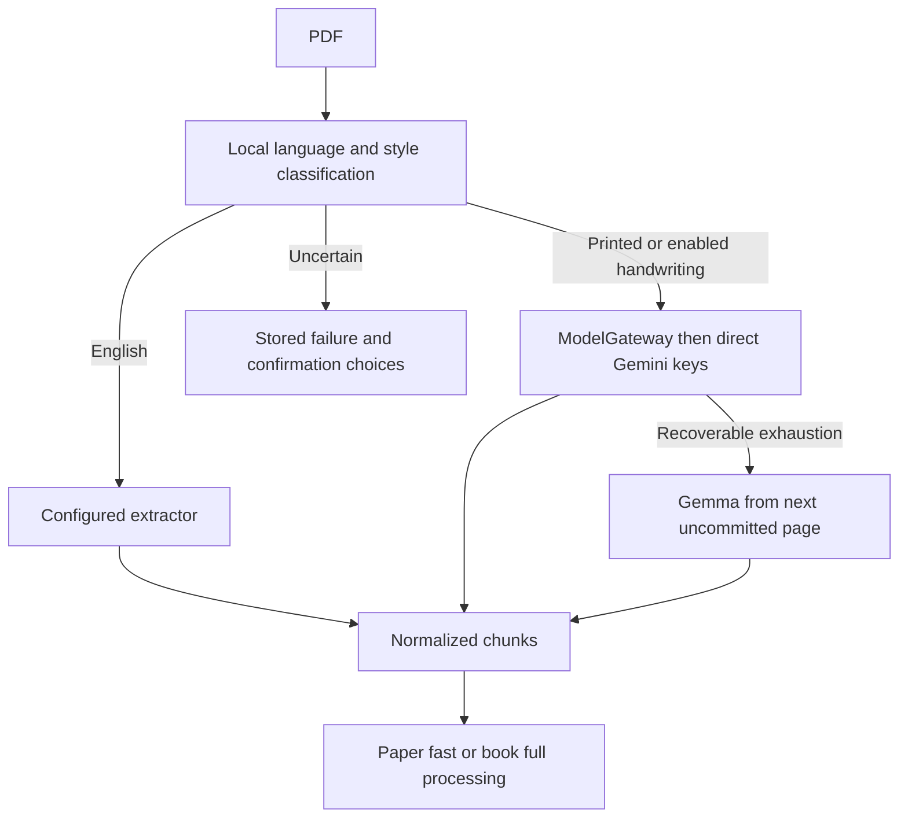

# Arabic document routing

> **Status:** current source behavior, checked 2026-10-12 against `d73d5e9`.
> Defaults and provider access are separate: use the
> [configuration reference](../03-reference/configuration.md#arabic-document-routing-and-ocr)
> and [operator runbook](../runbooks/arabic-document-ocr.md).

## 119. Arabic PDF classification, OCR and RTL reading

**What it does.** Before extracting a PDF, classify its language and Arabic writing style.
Arabic and mixed-language content enters an OCR path that records page provenance and
sets RTL document direction. Both uploaded papers and books use this PDF path; HTML
article imports use their existing importer.

**Where.** [`pipeline_sync.py`](../../backend/app/extraction/pipeline_sync.py)
(`_get_arabic_classification`, `_persist_arabic_classification`, `_run_extract`),
[`arabic_classifier.py`](../../backend/app/extraction/arabic_classifier.py),
[`gemini_ocr_client.py`](../../backend/app/extraction/gemini_ocr_client.py),
[`arabic_ocr.py`](../../backend/app/extraction/arabic_ocr.py),
[`arabic_adapter.py`](../../backend/app/extraction/arabic_adapter.py),
[`documents.py`](../../backend/app/api/v1/endpoints/documents.py)
(`confirm_arabic_writing_style`), and
[`UploadNotice.tsx`](../../frontend/src/views/UploadNotice.tsx).

**How it works.** With `ARABIC_OCR_ENABLED=true`, inspect every PDF page's selectable
text and use the configured local Ollama vision classifier where text alone cannot
determine language/style. A clear English text layer can avoid a model call. Visual
Arabic decisions need confidence checks; an unresolved style abstains.

| Classification | Extraction/result |
| --- | --- |
| `english` | Existing `resolve_extractor` dispatcher: MinerU, VLM or PyMuPDF as configured. |
| `arabic_printed` | Writing-style-aware Arabic OCR; includes printed mixed Arabic/English. |
| `arabic_handwritten` | Handwritten OCR when its flag is enabled; otherwise `handwritten_arabic_unavailable`. |
| `arabic_style_uncertain` | Fail with `arabic_style_confirmation_required`; expose printed/handwritten confirmation choices. |

```text
PDF -> local language/style classification
    -> English -> configured extractor
    -> Arabic printed/handwritten -> ModelGateway if configured
                                  -> direct Gemini keys
                                  -> Gemma on recoverable exhaustion
    -> uncertain -> stored failure -> user confirmation
Extraction -> normalized chunks -> paper fast / book full processing
```



The gateway is optional; when configured it precedes direct Google keys. Printed and
handwritten requests use different configured model identifiers. Recoverable failures
can preserve complete pages and continue with Gemma at the next uncommitted page.
Requests, pages and whole-document output are validated before publication. A limited
unreadable-page budget can retain an explicit marker; it is not permission to invent text.
Gemma-origin text has a provenance-gated repair path; other Arabic extractor output
does not go through MinerU-specific glyph/heading repair.

The document and progress payloads report `detected_language`, `detected_writing_style`,
`text_direction`, classifier metadata, `ocr_provider_summary` and typed error/action
fields. This lets the library and reader explain failures and choose document direction.
The application chrome keeps its existing layout.

**Confirmation limit.** `POST /api/v1/papers/{paper_id}/arabic-writing-style` accepts
`{"writing_style":"printed"}` or `{"writing_style":"handwritten"}` only for an
eligible failed job owned by the caller. Printed confirmation requeues that same job
through normal admission. Manual handwritten confirmation still records the selection
and returns unavailable without queueing OCR, even though confident automatic
handwriting has a pipeline branch. The endpoint's current behavior is the contract.

**Why.** Language and writing style decide which extractor can handle a PDF. Abstention,
typed failures and page provenance make recovery inspectable and prevent a guessed route
or partial provider response from silently becoming a finished document.

**Verify.** Use `test_arabic_classifier.py`, `test_arabic_pipeline_routing.py`,
`test_gemini_ocr_client.py`, `test_arabic_ocr_fallback.py`, `test_arabic_adapter.py`
and `test_arabic_confirmation_api.py` under `backend/tests/`, plus the actual filenames in
the [test plan](../04-testing/test-plan.md). Use the approved corpus procedure in the
runbook for quality measurements; unit tests do not establish OCR precision or cost.
